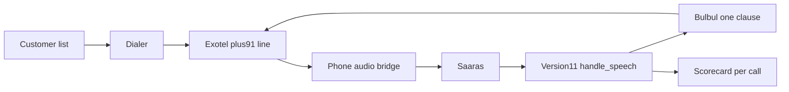

# Outbound calls for 400–500 customers

The improved call stays in Version 11. The browser page on port 8018 is one caller at a time. A real phone call today does not use that path.

## What stays

- The script in [Version11/app_v3.py](Version11/app_v3.py): greeting, region, project facts, visit close, and Hindi or Kannada switch. `handle_speech` remains the only place that decides what to say.
- The caller stays `sarvam-105b-conversations`. Ishita, pace 1.0, and temperature 0.6 stay. A Bulbul miss still falls through to Neerja on the English clause.
- Speech recognition stays Sarvam Saaras, and one clause is still translated at speak time.
- Version 10 and the current Lightsail service stay untouched. [make_call.py](make_call.py) dials one number at `{PUBLIC_URL}/voice` on the old service. The Gather action in Version 11 is still hardcoded to `https://s-ai-calling-agent.duckdns.org/handle-speech`, and [say_block](Version11/app_v3.py) still speaks with Polly. That phone path is not the prototype.

## What is in the way

- [conversation_memory](Version11/app_v3.py) is one dictionary for the whole process. Two overlapping calls would mix their answers. The same is true of the single [CallLog](Version11/local_call/call_record.py).
- Twilio’s own `<Gather>` and `<Say>` would replace Saaras and Bulbul. The phone company only places and carries the call. The audio is handled by the existing listen, turn, and speak steps.
- The current Twilio number is a US trial number. A trial can call only verified numbers, which is why it reached only your own phone. Twilio does not sell a voice-enabled Indian number, and its India rule is that calls into India are placed from a non-Indian number. A US caller ID is the wrong line for 400–500 Indian customers.

## Changes

- Use Exotel for the phone line. Its Connect Voice AI call opens one bidirectional WebSocket to our bridge, and Exotel already documents that socket for Sarvam Saaras and Bulbul. The script stays ours. Knowlarity can stream audio, but the public path is a contact-center setup rather than one dial request. Servetel’s dialer API expects a human agent. Tata Tele Smartflo can stream audio, with a setup fee and no public self-serve trial. Airtel IQ’s public voice API is click-to-call and recorded IVR, not a socket for our own speech and voice. Twilio stays out of this campaign.
- Exotel’s free trial is for the proof call only. Exotel does not publish a call count. The pricing page gives 7 days and ₹500 of call and SMS credit; the trial-account page gives 15 days and ₹1,000. Either way, outbound calls go only to verified numbers, and the developer trial page caps that list at 10. Those 10 can be called again until the credit runs out. Voice streaming is a separate product and is not included in the listed phone-system plans. Company KYC and a paid ExoPhone are required before the 400–500. Connect Voice AI also has to be enabled on the account.
- Give each call its own memory and its own scorecard, keyed by that provider’s call id. The script functions keep reading `conversation_memory`; the phone bridge selects the right dictionary for that call before it runs a turn. A second call cannot see the first call’s project, language, or stage.
- Add a phone bridge beside [Version11/local_call/server.py](Version11/local_call/server.py). Exotel dials with `POST /v1/Accounts/{AccountSid}/Calls/connect` on `api.in.exotel.com`, `StreamType=bidirectional`, and `sample-rate=16000`. On answer it runs the same greeting as `/local/start`. Customer audio goes through the same Saaras listen step. The English transcript goes through `handle_speech`. Each clause goes through the same speak step, including one translation and the Neerja fallback. Exotel plays that audio. The bridge does not add a new reply.
- Add a dialer that reads a customer list kept outside git: Indian mobile numbers, and nothing the script needs to change. It places calls through Exotel, records the call id, and writes the same scorecard the local page already writes. It does not retry a call that already closed, including “not interested.” A no-answer can be tried once later. A cap starts at one call at a time.
- Run this as its own service, with its own public address. Do not restart `ai-calling-agent.service`, and do not point these calls at the current DuckDNS voice URL.

## Testing while this is built

The browser page at `http://127.0.0.1:8018/` stays the way the script and voice are checked. Building the phone bridge does not replace that page, and it does not need Exotel.

A real Exotel ring cannot reach `127.0.0.1` by itself. For the proof call, the same Version 11 process on this machine is exposed with a temporary public `wss` address. Exotel dials one verified number and streams audio to that address. The live Lightsail service is not that address.

## How the 400–500 are placed

One answered call is a few minutes, and many people will not pick up. Five hundred calls are a campaign across calling hours, not one burst. After the single proof call sounds like the browser call, raise the cap only as far as Sarvam and the Indian line stay reliable. Five at a time is the working target before any larger number. The list is dialed only where the customer has agreed to the call, during daytime hours. A foreign caller ID is not used for that list.

The first proof is one number. Then a short list. The full 400–500 starts only after those scorecards match the local call: same script, same voice, one scorecard per customer, and no mixed conversations.
